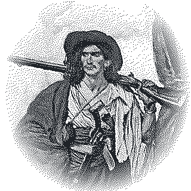

<!-- portrait: "The Buccaneer was a Picturesque Fellow", Howard Pyle, 1905 (public domain) -->
<picture>
  <source media="(prefers-color-scheme: dark)" srcset="assets/bee-dark.png">
  
</picture>

<picture>
  <source media="(prefers-color-scheme: dark)" srcset="assets/title-dark.svg">
  
</picture>

born to be a pirate, that's why i ship.

after hours i build things i actually want to use, and sometimes i even finish them.

### made

**[promptbutton](https://github.com/Hade6556/promptbutton)** — press it and your prompt gets better. there's a physical button version too, because why not.

**[arena-brain](https://github.com/Hade6556/arena-brain)** — tells me what to buy in league arena. i still lose, just with better information.

**[FQR](https://github.com/Hade6556/FQR)** — attendance tracker that guilt-trips you in lithuanian for skipping class.

### uses

typescript · vue · node · next.js

---

vilnius, lt

don't

 

fine. this is who reviews my code.

