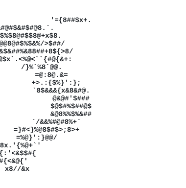

<picture>
  <source media="(prefers-color-scheme: dark)" srcset="assets/skull-dark.svg">
  
</picture>

<picture>
  <source media="(prefers-color-scheme: dark)" srcset="assets/title-dark.svg">
  
</picture>

born to be a pirate, that's why i ship.

after hours i build things i actually want to use, and sometimes i even finish them.

### made

**[promptbutton](https://github.com/Hade6556/promptbutton)** — press it and your prompt gets better. there's a physical button version too, because why not.

**[arena-brain](https://github.com/Hade6556/arena-brain)** — tells me what to buy in league arena. i still lose, just with better information.

**[FQR](https://github.com/Hade6556/FQR)** — attendance tracker that guilt-trips you in lithuanian for skipping class.

### uses

typescript · vue · node · next.js

---

vilnius, lt

<details>
<summary><sub>x marks the spot</sub></summary>

```
  ~      ~          ~        ~
     . - - - .            ~
  ~ '         ' - .
   .      ~        ' .      ~
   '                  '
     ~        ~        .  x
  ~                          ~

  54.6872 n, 25.2797 e

  qrnq zra gryy ab gnyrf.
  tvg ybt qbrf.
```

</details>
